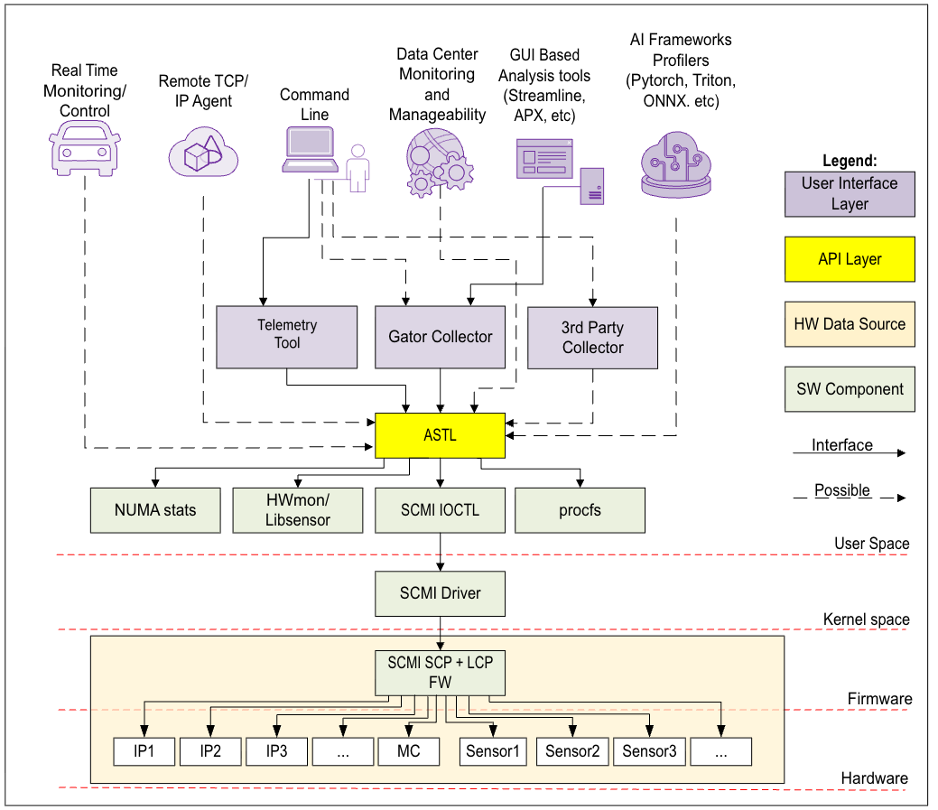
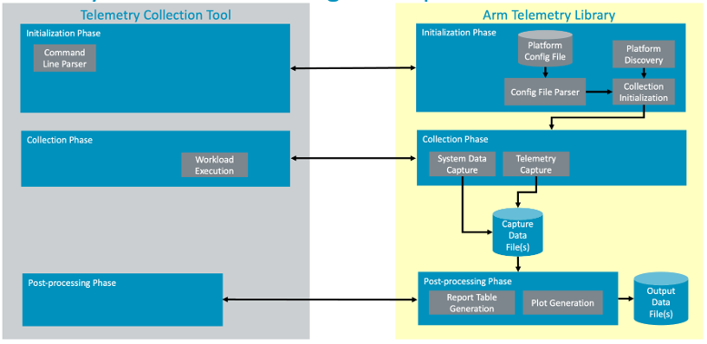
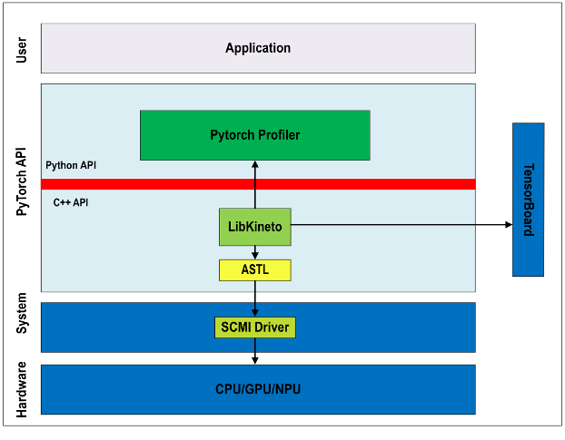
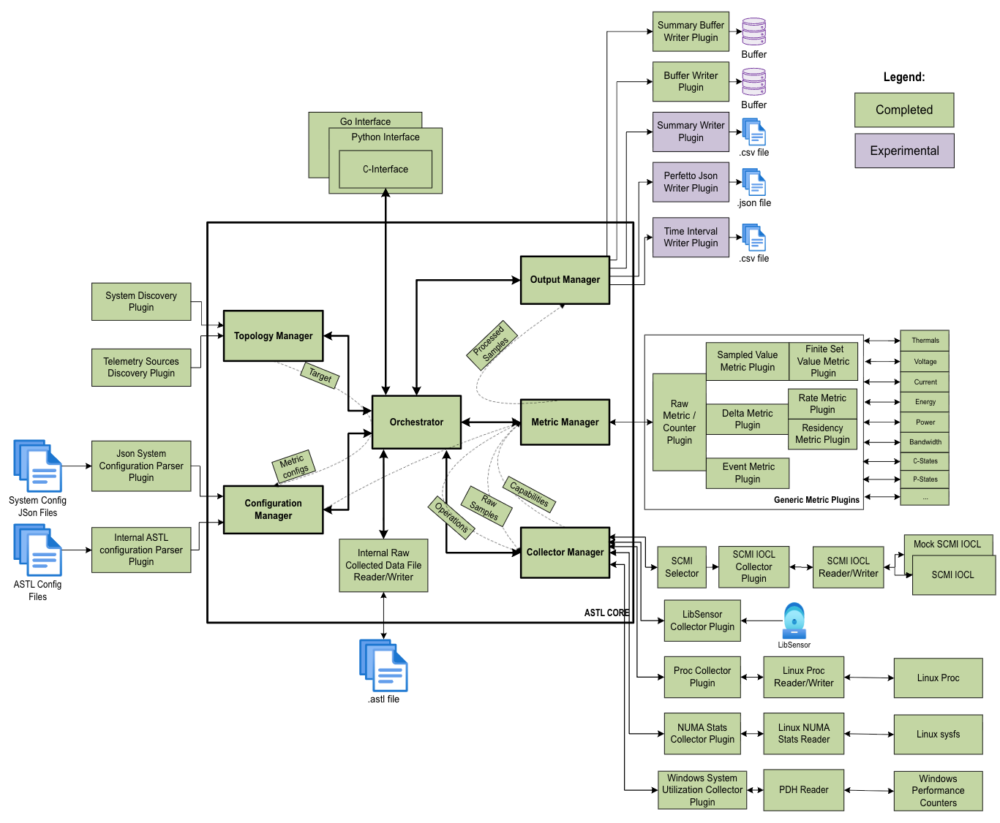
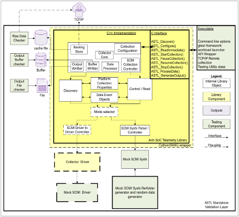

<!--
SPDX-FileCopyrightText: Copyright 2026 Arm Limited and/or its affiliates <open-source-office@arm.com>

SPDX-License-Identifier: Apache-2.0
-->

# ASTL

[](https://github.com/Arm-Debug/ASTL/actions/workflows/integration.yml)
[](https://github.com/arm/ASTL/tree/badges)
[](https://github.com/arm/ASTL/blob/badges/fuzz-coverage.json)

Arm SoC Telemetry Library

## Description

ASTL is a library for SoC telemetry collection at Arm. It abstracts low level
interfaces to telemetry data sources on the system. Using a predefined API, a telemetry
collection tool or an AI framework can dynamically discover available supported telemetry on
the target platform, configure, start, pause, resume, and stop a collection, then process
collected data. Collected data can be streamed directly to a user provided buffer or exported
through the experimental Perfetto JSON trace, Interval CSV, and Summary CSV outputs.

See [Output Formats](#output-formats) for details on in-memory buffer output and the
experimental file outputs.

ASTL supports telemetry from the following sources, depending on the platform and build options:

- System Control and Management Interface (SCMI) through Linux telemetry ioctl and legacy sysfs interfaces.
- Linux procfs system telemetry.
- hwmon sensors through libsensors.
- Linux NUMA allocation statistics through sysfs; see [NUMA telemetry](doc/numa.md).
- Windows Performance Data Helper (PDH) system metrics; see
  [Windows PDH telemetry](doc/windows_pdh_system_collector.md).

The library has a C API and a C++ implementation. Language wrappers are available for
**[Python](python/doc/USER_GUIDE.md)** through Cython bindings and high-level utilities,
and **[Go](Go/README.md)** through cgo bindings to the ASTL C API.

## Key Goals and Properties

### Sharable

- New and existing tools at Arm can use it.
- Partners and external third-party tool developers can use it to access telemetry on Arm platforms.

### Uniform

- Telemetry collection through a fixed, predefined API surface.

### Portable

- Rebuild on Windows or other OSs with the same user API interface.
- Python (Cython) and Go (cgo) wrapper support.

### Extensible

- Driver-to-driver context-switch based collection.
- SCMI specification extensions.
- Additional platform-level telemetry access mechanisms.

### Reusable

- Can be deployed across IoT, automotive, client, data center, GPU, and NPU platforms.
- Can be used by telemetry collection tools, AI frameworks, or directly to instrument workloads.

## Architecture and collection flow

Telemetry tools and AI frameworks use ASTL's C API, directly or through the Python
(Cython) and Go (cgo) bindings, to discover telemetry sources, configure collection, and retrieve
samples and summaries.

### High-level architecture



### Telemetry collection tool usage example



### AI framework usage example



### Implementation architecture



See the [detailed class relationships](doc/design/orchestrator.svg) and
[Mermaid source](doc/design/orchestrator.mmd) for the orchestrator, managers,
collectors, targets, and metrics.

## Testing and Isolation Methodology



- Complete isolation from all dependencies
- Mock mode SCMI sysfs file/folder generator
- Mock mode data generator

- Bench testing suite
- trompeloeil and Catch2 unit testing
- Mock command line collector executable

## Installation and usage

### Installation

Clone the public repository, then follow the
[build steps for developers](#build-steps-for-developers):

```sh
git clone https://github.com/arm/ASTL.git
cd ASTL
```

For native Android builds and procfs collection through `adb shell`, see
[Android development and CI](doc/android.md). Apple Silicon Macs can build and
run the Arm64 emulator workflow locally.

ASTL uses a single configuration source, selected in this order:

1. The directory specified by `ASTL_CONFIG_DIR`, when set.
2. A `config/` directory beside the loaded ASTL library, or beside the executable
   when ASTL is statically linked.
3. The configuration embedded in the library.

Sources are not combined. No OS-specific user or system config directories are
searched. An invalid explicit directory (including an empty `ASTL_CONFIG_DIR`)
or invalid contents in the selected directory cause an error, without falling
back to another source.

Configuration references (`extends`, `metrics_file`, and `specification_file`)
must be relative to the referring JSON file and resolve to a JSON file within the
selected config directory. Absolute paths and paths escaping that directory are
rejected.

Every build embeds configuration. `ASTL_EMBED_CONFIG_DIR` selects the prepared input
tree at configure time (default: this project's `config/`). Prepare any custom
configuration input tree before configuring the build. `ASTL_RELEASE_PROFILE`
identifies the embedded input set in the generated resource manifest.

See [Build steps for developers](#build-steps-for-developers) for more detailed build instructions.

> Looking for language wrappers? See the
> **[ASTL Python User Guide](python/doc/USER_GUIDE.md)** for: initialization, streaming (sync &
> async), diagnostics CLI, derived metrics, DataFrame integration, benchmarking,
> metric state discovery (`get_metric_states_on_target` / `MetricState`), and
> exception model. For Go/cgo installation and usage, see the
> **[Go User Guide](Go/README.md)**.

### Usage

The complete flow is demonstrated in
[`samples/sample_test/src/sample_test.cpp`](samples/sample_test/src/sample_test.cpp).
Below are the minimal snippets you need:

```cpp
#include "astl/astl.h"
#include "astl/astl_telemetry.h"

#include <string>
#include <vector>
```

`astl_telemetry.h` is self-contained for pure C consumers as well. The helper macros
`ASTL_INIT_STRUCT`, `ASTL_ALLOC_ARRAY`, and `ASTL_FREE_ARRAY` are intended to work in both C and C++ translation units.

1. Provide a telemetry source.

ASTL discovers available telemetry sources through the collectors included in the build.
For SCMI telemetry, ASTL automatically probes ioctl character devices under
`/dev/scmi` and uses them when available. If no usable ioctl target is found,
ASTL falls back to the legacy SCMI telemetry sysfs interface under
`/sys/fs/arm_telemetry`.

On current platforms, ASTL supports SCMI sampling through direct reads or
periodic polling only. Event-driven or notification-based sampling is not
currently supported.

For legacy sysfs-only systems, mount the sysfs interface:

```bash
mount -t stlmfs none /sys/fs/arm_telemetry/
```

2. Initialize ASTL

The procfs collector exposes the `sysutil` target with portable CPU and memory
metric names. See [System utilization](doc/system_utilization.md) for the names,
sampling semantics, and migration from the old procfs names.

Windows builds include system CPU and physical-memory telemetry by default; see
[Windows PDH telemetry](doc/windows_pdh_system_collector.md) for metrics and sampling semantics.

On Linux, the NUMA collector exposes the `numa` target when readable NUMA statistics
are available in sysfs. See [NUMA telemetry](doc/numa.md) for allocation counters,
locality percentages, and sampling semantics.

Use these environment variables to select collectors or redirect backend paths:

- `ASTL_COLLECTORS`: comma-separated allowlist of collectors used for live
  discovery. Supported names are `scmi`, `libsensors`, `procfs`, `numa`, and `windows_pdh`. Unset or
  empty enables every collector included in the build. Known unavailable backends
  are skipped; unknown names or an explicit list with no available backend fail.
  Use `ASTL_COLLECTORS=procfs,windows_pdh` for portable system utilization through
  the `sysutil` target and `cpu.*` / `memory.*` metric names.
- `ASTL_SCMI_INTERFACE`: SCMI backend preference. Accepted values are `auto`,
  `ioctl`, and `sysfs`; unset or unknown values use `auto`.
- `ASTL_SCMI_IOCTL_DEV_ROOT`: ioctl device root. Defaults to `/dev/scmi`.
- `ASTL_SCMI_SYSFS_TELEMETRY_ROOT`: legacy sysfs telemetry root. Defaults to
  `/sys/fs/arm_telemetry`.
- `ASTL_PROCFS_ROOT`: procfs root used for topology discovery, metric discovery,
  and collection. Defaults to `/proc`.
- `ASTL_NUMA_ROOT`: NUMA sysfs node root. Defaults to `/sys/devices/system/node`.
- `ASTL_SAMPLE_BATCH_SIZE`: maximum number of samples retained or visited in one
  batch. It must be an integer from `1` through `1048576` and defaults to
  `1024`. Invalid values are ignored with a warning.

Some developers might have a reason to use modified platform definition and metrics config files.
You can use ASTL_CONFIG_DIR for this.

```bash
# optional - discover only SCMI targets and metrics
export ASTL_COLLECTORS="scmi"
# optional - force the legacy sysfs backend, for example when using MockSysfs
export ASTL_SCMI_INTERFACE="sysfs"
# optional - if SCMI ioctl devices are not under /dev/scmi
export ASTL_SCMI_IOCTL_DEV_ROOT="/path/to/scmi-devices"
# optional - if your SCMI sysfs is not in the expected mount point
export ASTL_SCMI_SYSFS_TELEMETRY_ROOT="/sys/fs/arm_telemetry"
# optional - use a synthetic procfs tree (for example in deterministic tests)
export ASTL_PROCFS_ROOT="/path/to/procfs-fixture"
# optional - use a synthetic NUMA sysfs node tree
export ASTL_NUMA_ROOT="/path/to/numa-fixture"
# optional - tune the bounded sample batch size
export ASTL_SAMPLE_BATCH_SIZE="2048"
# optional - if you're hacking around with metric definitions
export ASTL_CONFIG_DIR="/path/to/my_astl/config"
```

For `libsensors` targets, ASTL also looks for optional metric metadata files under
`$ASTL_CONFIG_DIR/metrics/libsensors/` or the built-in `config/metrics/libsensors/` directory.
ASTL first looks for an exact file matching the discovered target name and then falls back to progressively less
specific chip-family files. For example, an `nvme-pci-40100` target will fall back to `libsensors_nvme-pci.json` if no
exact override exists. This avoids relying on PCI addresses to predict which subfeatures a device exposes.
If no file exists, ASTL discovers and registers all readable sensor metrics across all supported feature families.
If an exact target file exists, it acts as an allowlist: only declared metrics are registered, and ASTL warns when a
declared metric is not present on the current system. If a fallback family file exists, ASTL still uses lm-sensors
enumeration to decide which metrics exist on the current machine and only uses the JSON file as a metadata overlay for
matching sensors. Undeclared discovered sensors continue to register with default metadata in that fallback case.
These declaration files can attach descriptions, metric groups, and formulas. Any explicit scaling should now be
expressed directly in `formula`, for example `value / 1000`. To reduce duplication, a libsensors declaration file may
also use a relative `"extends"` path to inherit from a shared template file. Child files override any top-level
metadata and replace or add individual metrics by key.

For repetitive derived metric declarations, libsensors metrics also support an optional
`"derived_metrics"` object on a base metric. This is used to automatically generate related metrics from a single source
(e.g., alarm/limit variants of a temperature or voltage sensor). Each key selects the derived metric kind. Supported keys include:
`low`/`min`, `high`/`max`, `critical`/`crit`, `emergency`/`emerg`, `alarm`, and `beep`. Each nested object can override
fields such as `description`. ASTL automatically expands those into sibling declaration entries (e.g.,
`Composite_thermal_limit_high`, `Composite_thermal_limit_emergency`, `Composite_alarm`), preserving the base metric's
units, formula, and metric groups. When metrics are discovered via lm-sensors or a fallback family file,
unsupported or unavailable derived metric keys are silently skipped if the corresponding subfeature is not present
on the current system. When an exact target file is used as an allowlist, ASTL instead emits a warning for each
declared derived metric whose subfeature is not observed on the current system.

Within the selected configuration directory, metric declaration files contain a
`metrics` object. For example:

```json
{
  "metrics": {
    "Throttle Counts": {
      "description": "Number of thermal throttling events",
      "unit": "",
      "metric_type": "delta",
      "identifier": "THERMAL_THROTTLE",
      "metric_groups": ["throttling"],
      "collection": {
        "register": "THROTTLE_EVENTS",
        "protocol": "scmi"
      }
    }
  }
}
```

Each metric uses its name as the object key. Its fields include:

- `description`: describes the metric.
- `collection.register`: names the register or source value to read.
- `collection.protocol`: selects the collector, for example `scmi`.
- `unit`: selects the output unit. For SCMI, an empty value inherits the source
  unit; a nonempty value must match it unless an explicit formula overrides the
  output unit.
- `metric_type`: selects the metric's processing, for example `value`, `delta`, or `rate`.

For more details on metrics declarations and platform-specific scmi spec, see [doc/config_and_specification_files.md](doc/config_and_specification_files.md)

### Formula Support

ASTL supports flexible data transformation through formulas that can be applied to raw metric values. Formulas allow you to:

- Extract bit fields from raw register values
- Apply integer scaling and transformations
- Perform complex mathematical operations
- Combine bitwise and arithmetic operations

#### Formula Types

**String Expressions** (using [tinyexpr++](https://github.com/Blake-Madden/tinyexpr-plusplus) in uint64_t mode):
Express transformations as mathematical expressions using the variable name `value`.
The following declarations illustrate the schema; replace the placeholder register
names with registers from your platform's telemetry specification:

```json
{
  "metrics": {
    "scaled_value": {
      "description": "Scale a raw sensor value using integer division",
      "metric_type": "value",
      "unit": "none",
      "collection": {
        "register": "sensor_raw",
        "protocol": "scmi"
      },
      "formula": "value / 1000"
    },
    "power_watts": {
      "description": "Convert a raw milliwatt reading to watts",
      "metric_type": "value",
      "unit": "W",
      "collection": {
        "register": "power_sensor",
        "protocol": "scmi"
      },
      "formula": "value / 1000"
    },
    "combined_bits": {
      "description": "Mask and combine raw register bits",
      "metric_type": "value",
      "unit": "none",
      "collection": {
        "register": "control_reg",
        "protocol": "scmi"
      },
      "formula": "(value & 0xFF00) | 0x42"
    }
  }
}
```

**Supported Operations:**

- Arithmetic: `+`, `-`, `*`, `/`, `%`
- Bitwise: `&` (AND), `|` (OR), `^` (XOR), `~` (NOT)
- Shift: `>>` (right shift), `<<` (left shift)
- Logical: `&&`, `||`, `!`
- Comparison: `<`, `>`, `<=`, `>=`, `==`, `!=`
- Parentheses for grouping

**UINT64_T Mode:**
TinyExpr++ is compiled with `TE_UINT64` and `TE_BITWISE_OPERATORS`.
Expressions use unsigned 64-bit integer arithmetic; integer division discards any remainder.

**Important Notes:**

- Only integer numeric literals are accepted. Decimal literals such as `0.001` and
  scientific notation such as `1e3` are rejected with `ASTL_STATUS_BAD_CONFIGURATION`.
- Use `"value / 1000"` for integer scaling; `"value * 0.001"` is rejected.
- For more details on expression syntax, see the [tinyexpr++ documentation](https://github.com/Blake-Madden/tinyexpr-plusplus#functions)

---

3. Discover targets

```cpp
uint32_t target_count = 0;
ASTL_INIT_STRUCT(astl_get_target_count_params_t, get_target_count_params,
                 .flags = 0,
                 .target_count = &target_count);
astl_status_code status = astlGetTargetCount(&get_target_count_params);
if (status != ASTL_STATUS_SUCCESS || target_count == 0) {
  // skip astlGetTargets when target_count == 0
  return;
}
// allocate an array to hold the properties of each target
ASTL_ALLOC_ARRAY(astl_target_props_t, target_properties_buffer, target_count);
if (!target_properties_buffer) {
  return;
}
ASTL_INIT_STRUCT(astl_get_targets_params_t, get_targets_params,
                 .flags = 0,
                 .targets = target_properties_buffer,
                 .target_count = &target_count);
status = astlGetTargets(&get_targets_params);
if (status != ASTL_STATUS_SUCCESS || target_count == 0) {
  ASTL_FREE_ARRAY(target_properties_buffer);
  return;
}
// using the first target
astl_target_props_t target_properties = target_properties_buffer[0];
```

4. Configure collection

Calling any `astlConfigure*Collection*` API starts a clean collection session when collection is not
running. If a previous collection has reached `STOPPED`, retrieve or save any samples you still need
before configuring again. The next configure call clears previous collection-scoped data such as
cached samples, processed samples, clock correlations, and operation mappings. Target discovery,
metric definitions, and metric handles remain available.

Configuration also captures a clock correlation for each sample operation, after enabling its data source.
Immediate reads and start/pause/resume reuse that mapping until reconfiguration, keeping sample timestamps
on a consistent timeline. If correlation fails, configuration returns an error and the affected target
must be configured successfully before collecting samples.

```cpp
uint32_t metric_count{};
ASTL_INIT_STRUCT(astl_get_metric_count_params_t, get_metric_count_params,
    .flags = 0,
    .target_handle = target_properties.handle,
    .metric_count = &metric_count);
status = astlGetMetricCountOnTarget(&get_metric_count_params);
if (status != ASTL_STATUS_SUCCESS || metric_count == 0) {
    // skip astlGetMetricsOnTarget when metric_count == 0
    ASTL_FREE_ARRAY(target_properties_buffer);
    return;
}
std::vector<astl_metric_props_t> metric_buffer(metric_count);
metric_buffer[0].size = sizeof(astl_metric_props_t);
ASTL_INIT_STRUCT(astl_get_metrics_params_t, get_metrics_params,
    .flags = 0,
    .target_handle = target_properties.handle,
    .metrics = metric_buffer.data(),
    .metric_count = &metric_count);
status = astlGetMetricsOnTarget(&get_metrics_params);
if (status != ASTL_STATUS_SUCCESS || metric_count == 0) {
    ASTL_FREE_ARRAY(target_properties_buffer);
    return;
}
metric_buffer.resize(metric_count);

// Handles are fields within property structs, so gather them into a separate array.
std::vector<astl_metric_handle_t> metric_handles;
metric_handles.reserve(metric_buffer.size());
for (const auto& metric : metric_buffer) {
    metric_handles.push_back(metric.handle);
}

ASTL_INIT_STRUCT(astl_collection_params_t, collection_params,
    .flags = ASTL_COLLECTION_PARAMETERS_FLAG_OPTIMIZE_OVERHEAD,
    .sampling_interval = 0,
    .collection_mode = ASTL_COLLECTION_MODE_IMMEDIATE,
);
ASTL_INIT_STRUCT(astl_configure_metric_collection_on_target_params_t, configure_metric_params,
    .flags = 0,
    .target_handle = target_properties.handle,
    .collection_params = &collection_params,
    .metric_handles = metric_handles.data(),
    .metric_count = metric_count);
status = astlConfigureMetricCollectionOnTarget(&configure_metric_params);
if (status != ASTL_STATUS_SUCCESS) {
    ASTL_FREE_ARRAY(target_properties_buffer);
    return;
}
```

After a target is configured, ASTL can also create a native event metric for that target named
`astl_lifecycle_events.<target-name>`. This metric is generated by ASTL itself (not by an external
hardware collector) and records lifecycle events (pause, resume, and crop boundaries) for that
target. It is created lazily, the first time one of those lifecycle events actually occurs for the
target (i.e. on the first pause, resume, or crop), so it does not exist for sessions that never
pause, resume, or crop.

Because the lifecycle metric is created lazily, callers must rediscover the target's metrics after
the first pause, resume, or crop. Call `astlGetMetricCountOnTarget(...)` and
`astlGetMetricsOnTarget(...)` again before scanning the updated metric set.

Event metrics use `UINT8`, `UINT16`, `UINT32`, or `UINT64` output values as enum-like event codes and can publish
typed event properties. Query each `ASTL_METRIC_EVENT` metric with
`astlGetMetricEventCountOnTarget(...)` and `astlGetMetricEventsOnTarget(...)`. The lifecycle
metric is identified by its canonical `ASTL_LIFECYCLE_PAUSE`, `ASTL_LIFECYCLE_RESUME`,
`ASTL_LIFECYCLE_CROP_BEGIN`, and `ASTL_LIFECYCLE_CROP_END` events. These names are reserved for
ASTL's synthetic lifecycle metric. This makes the mapping unique, so callers do not need to
construct or parse its internal metric name. Use the identified metric handle with
`astlGetMetricSamplesOnTarget(...)` to retrieve the lifecycle event samples. An event metric
without configured event properties returns a count of zero.

The caller allocates the `astl_event_props_t` array and initializes its first element's `size`.
ASTL owns the `name` and `description` strings for the active session; each pointer is non-NULL,
may refer to an empty string, uses no fixed character buffer, and is not truncated.

Alternatively, we can configure collection by metric groups

```cpp
auto CollectFirstGroup(astl_target_handle_t target) -> void {
uint32_t metric_group_count{};
ASTL_INIT_STRUCT(astl_get_metric_group_count_on_target_params_t, get_group_count_params,
                 .flags = 0,
                 .target_handle = target,
                 .metric_group_count = &metric_group_count);
auto status = astlGetMetricGroupCountOnTarget(&get_group_count_params);
if (status != ASTL_STATUS_SUCCESS || metric_group_count == 0) {
    return;
}

std::vector<astl_metric_group_props_t> metric_groups_properties(metric_group_count);
metric_groups_properties[0].size = sizeof(astl_metric_group_props_t);

// retrieve the metric groups
ASTL_INIT_STRUCT(astl_get_metric_groups_on_target_params_t, get_groups_params,
                 .flags = 0,
                 .target_handle = target,
                 .metric_groups = metric_groups_properties.data(),
                 .metric_group_count = &metric_group_count);
status = astlGetMetricGroupsOnTarget(&get_groups_params);
if (status != ASTL_STATUS_SUCCESS || metric_group_count == 0) {
    return;
}

// collect on the first group (you could instead look at the properties and filter by name)
std::vector<astl_metric_group_handle_t> groups{metric_groups_properties[0].handle};
const uint32_t groups_count = static_cast<uint32_t>(groups.size());
ASTL_INIT_STRUCT(astl_collection_params_t, collection_params,
                 .flags = ASTL_COLLECTION_PARAMETERS_FLAG_OPTIMIZE_OVERHEAD,
                 .sampling_interval = 0,
                 .collection_mode = ASTL_COLLECTION_MODE_IMMEDIATE);

ASTL_INIT_STRUCT(astl_configure_metric_group_collection_on_target_params_t, configure_group_params,
                 .flags = 0,
                 .target_handle = target,
                 .collection_params = &collection_params,
                 .metric_group_handles = groups.data(),
                 .metric_group_count = groups_count);
status = astlConfigureMetricGroupCollectionOnTarget(&configure_group_params);
}
```

The same post-event metric rediscovery and event-property scan applies when collection is
configured by metric group.

If you need the metrics that belong to a metric group regardless of target, first retrieve the
global group descriptors with `astlGetMetricGroups(...)`, then call
`astlGetMetricGroupMetricCount(...)` to size the buffer and `astlGetMetricGroupMetrics(...)` to
fetch the metric properties. Use `astlGetMetricGroupMetricCountOnTarget(...)` plus
`astlGetMetricGroupMetricsOnTarget(...)` when you need the group membership filtered to a specific
target.

5. Start, read, and stop collection (including paused start)

Choose one start mode for a configured target. For a normal start:

```cpp
ASTL_INIT_STRUCT(astl_start_collection_on_target_params_t, start_params,
                 .flags = 0,
                 .target_handle = target_properties.handle);
status = astlStartCollectionOnTarget(&start_params);
```

To start the target paused instead, use this alternative:

```cpp
ASTL_INIT_STRUCT(astl_start_collection_on_target_paused_params_t, start_paused_params,
                 .flags = 0,
                 .target_handle = target_properties.handle);
status = astlStartCollectionOnTargetPaused(&start_paused_params);  // final state after call: PAUSED
```

For all configured targets, choose either `astlStartCollection(...)` or
`astlStartCollectionPaused(...)` instead of either per-target start above. For example:

```cpp
ASTL_INIT_STRUCT(astl_start_collection_paused_params_t, start_all_paused_params,
                 .flags = 0);
status = astlStartCollectionPaused(&start_all_paused_params);  // all CONFIGURED targets -> PAUSED
```

Aggregate starts are transactional: if one configured target fails to start,
ASTL stops any earlier targets started by the same call before returning.

After a successful normal start, sampling can be paused and resumed. A target
started paused only needs the resume call. Collectors can return
`ASTL_STATUS_PAUSE_UNSUPPORTED` or `ASTL_STATUS_RESUME_UNSUPPORTED` when the
operation is unavailable.

```cpp
// Optional: temporarily suspend sampling after a normal start
ASTL_INIT_STRUCT(astl_pause_collection_on_target_params_t, pause_params,
                 .flags = 0,
                 .target_handle = target_properties.handle);
status = astlPauseCollectionOnTarget(&pause_params);   // collection state: PAUSED
ASTL_INIT_STRUCT(astl_resume_collection_on_target_params_t, resume_params,
                 .flags = 0,
                 .target_handle = target_properties.handle);
status = astlResumeCollectionOnTarget(&resume_params);  // back to STARTED
```

Read an immediate sample when the target is configured, started, or paused, then
stop after a successful start:

```cpp
ASTL_INIT_STRUCT(astl_read_immediate_on_target_params_t, immediate_params,
                 .flags = 0,
                 .target_handle = target_properties.handle);
status = astlReadImmediateOnTarget(&immediate_params);     // useful while CONFIGURED, STARTED, or PAUSED
ASTL_INIT_STRUCT(astl_stop_collection_on_target_params_t, stop_params,
                 .flags = 0,
                 .target_handle = target_properties.handle);
status = astlStopCollectionOnTarget(&stop_params);    // final state: STOPPED
```

6. Save or load a session (.astl)

ASTL can serialize a completed collection session into a single `.astl` file (and later reload it) for
post-processing/output generation.

Key rules:

- Always set the struct `size` field to `sizeof(struct)`.
- `flags` must be `0` (reserved for future use).
- The save output path must be non-NULL and non-empty; otherwise the API returns
  `ASTL_STATUS_BAD_ARGUMENT`.
- Call `astlSaveCollection()` after stopping collection.
- Save before calling any configure API for a new collection if you need to keep the stopped
  session's samples.
- After `astlLoadCollection()`, collection control APIs are disabled; only post-processing/output generation is possible.

#### Save

```c
#include "astl/astl_telemetry.h"

ASTL_INIT_STRUCT(astl_save_params_t, params,
                 .output_file_path = "/tmp/session.astl",
                 .flags = 0);

astl_status_code rc = astlSaveCollection(&params);
```

#### Load / import

```c
#include "astl/astl_telemetry.h"

ASTL_INIT_STRUCT(astl_load_params_t, params,
                 .input_file_path = "/tmp/session.astl",
                 .chunk_size_bytes = 0,  // reserved; 0 uses default
                 .flags = 0);

astl_status_code rc = astlLoadCollection(&params);
```

7. Crop samples (optional, post-collection)

`astlCropSamples` and `astlCropSamplesOnTarget` permanently discard any samples that fall outside
a supplied time window. This is useful when a loaded `.astl` archive contains more data than needed
for analysis, or to trim a live session before saving.

Key rules:

> [!CAUTION]
> The crop operation is **irreversible**. Once samples are discarded they cannot be recovered.

- Collection must be **stopped** before cropping; calling while a target is STARTED or PAUSED will return `ASTL_STATUS_COLLECTION_NOT_STOPPED`.
- A window with `start_ts = 0` has no lower bound; `end_ts = 0` has no upper bound.
- `window_count` must be ≥ 1.

#### Crop all targets

```c
#include "astl/astl_telemetry.h"

astl_crop_window_t window = {0};
window.size     = sizeof(astl_crop_window_t);
window.start_ts = 1000000000ULL;  // retain samples from 1 s onwards
window.end_ts   = 5000000000ULL;  // up to 5 s

astl_crop_samples_params_t params = {0};
params.size         = sizeof(astl_crop_samples_params_t);
params.windows      = &window;
params.window_count = 1;

astl_status_code rc = astlCropSamples(&params);
```

#### Crop a specific target

```c
#include "astl/astl_telemetry.h"

astl_crop_window_t window = {0};
window.size     = sizeof(astl_crop_window_t);
window.start_ts = 1000000000ULL;
window.end_ts   = 5000000000ULL;

astl_crop_samples_on_target_params_t params = {0};
params.size          = sizeof(astl_crop_samples_on_target_params_t);
params.target_handle = target_props.handle;
params.windows       = &window;
params.window_count  = 1;

astl_status_code rc = astlCropSamplesOnTarget(&params);
```

8. Retrieve metric samples

Query `astlGetMetricSampleCountOnTarget(...)`, allocate an `astl_sample_t` array
with that capacity, and fill it with `astlGetMetricSamplesOnTarget(...)`.
See [Timestamp Filtering](#timestamp-filtering) for a count-and-retrieve example
and [Output Formats](#output-formats) for optional file outputs.

9. Compute min/max/avg summary for a metric (post-collection)

After stopping collection, call `astlGetMetricStatisticsOnTarget` for any arithmetic metric to obtain
the minimum, maximum, average, and sample count over all collected samples. See the
[Metric Summary API](#metric-summary-api) section for full details.

```c
#include "astl/astl_telemetry.h"
#include <inttypes.h>
#include <stdio.h>

// Retrieve metric statistics (min/max/avg)
// target_properties and metric_buffer are populated by the discovery steps above.

astl_metric_statistics_t summary = {0}; // zero-initialize
summary.size = sizeof(astl_metric_statistics_t);
summary.flags = ASTL_METRIC_STATISTICS_FLAG_REGULAR_AVG;

ASTL_INIT_STRUCT(astl_get_metric_statistics_on_target_params_t, get_metric_stats_params,
                 .flags = 0,
                 .target_handle = target_properties.handle,
                 .metric_handle = metric_buffer[0].handle,
                 .summary = &summary);
astl_status_code rc = astlGetMetricStatisticsOnTarget(&get_metric_stats_params);

if (rc == ASTL_STATUS_SUCCESS && summary.count > 0) {
    // avg is always fp64 — safe for all arithmetic metric types
    printf("count=%" PRIu64 " avg=%.2f\n", summary.count, summary.avg.fp64);
}

```

10. Retrieve histogram bins for finite-set metrics (post-collection)

For metrics that take a finite set of values (e.g. frequency steps, residency states),
use the two-step `astlGetMetricDiscreteHistogramBinCountOnTarget` /
`astlGetMetricDiscreteHistogramOnTarget` API to obtain the exact distribution of observed values.
See the [Discrete Histogram API](#discrete-histogram-api) section for full details.

```cpp
#include <inttypes.h>

uint32_t bin_count = 0;
ASTL_INIT_STRUCT(astl_get_metric_discrete_histogram_bin_count_on_target_params_t,
                 bin_count_params,
                 .flags = 0,
                 .target_handle = target_properties.handle,
                 .metric_handle = metric_buffer[0].handle,
                 .bin_count = &bin_count);
astl_status_code rc = astlGetMetricDiscreteHistogramBinCountOnTarget(&bin_count_params);

if (rc == ASTL_STATUS_SUCCESS && bin_count > 0) {
    std::vector<astl_discrete_histogram_bin_t> bins(bin_count);
    bins[0].size = sizeof(astl_discrete_histogram_bin_t);

    ASTL_INIT_STRUCT(astl_get_metric_discrete_histogram_on_target_params_t,
                     histogram_params,
                     .flags = 0,
                     .target_handle = target_properties.handle,
                     .metric_handle = metric_buffer[0].handle,
                     .bins = bins.data(),
                     .bin_count = &bin_count);
    rc = astlGetMetricDiscreteHistogramOnTarget(&histogram_params);

    if (rc == ASTL_STATUS_SUCCESS) {
        // This example assumes an unsigned 64-bit metric value.
        for (uint32_t i = 0; i < bin_count; ++i) {
            printf("value=%" PRIu64 "  count=%" PRIu64 "\n", bins[i].value.ui64, bins[i].count);
        }
    }
}
```

11. Clean up allocated resources

```cpp
ASTL_FREE_ARRAY(target_properties_buffer);
```

For a runnable example, follow the [Linux procfs quick start](#linux-procfs-quick-start).
Use the optional [MockScmi setup](#running-mockscmi) to exercise SCMI telemetry.

## Metric Summary API

`astlGetMetricStatisticsOnTarget` computes min/max/avg/count over all collected samples for a metric on a target.
Call it after `astlStopCollectionOnTarget` or after `astlLoadCollection`.

`astl_metric_statistics_t` fields:

- `size`: Must be `sizeof(astl_metric_statistics_t)`.
- `flags`: `ASTL_METRIC_STATISTICS_FLAG_REGULAR_AVG` or `ASTL_METRIC_STATISTICS_FLAG_TIME_WEIGHTED_AVG`.
- `min` and `max`: Union members matching the metric's native value type.
- `avg`: Always read `summary.avg.fp64`.
- `count`: Number of samples included in the summary.

Common status codes:

- `ASTL_STATUS_SUCCESS`
- `ASTL_STATUS_BAD_ARGUMENT`
- `ASTL_STATUS_INVALID_FLAG_VALUE`
- `ASTL_STATUS_OLD_STRUCT_VERSION`
- `ASTL_STATUS_NEW_STRUCT_VERSION`
- `ASTL_STATUS_NOT_SUPPORTED`

Public status values are defined in [`astl_errors.h`](include/astl/astl_errors.h).
Their numeric values have reserved gaps. Internal failures are normalized to
`ASTL_STATUS_INTERNAL_ERROR` (`127`) at the public API boundary.

## String Pointer Lifetimes and Ownership

**Important:** `astlGetMetricStatesOnTarget` and `astlGetMetricEventsOnTarget` return
`const char*` pointers to names and descriptions. These pointers refer to internal storage owned by
ASTL. Callers allocate and free only the result struct arrays; they must not modify or free the
strings. There is no caller-provided character-array size and ASTL does not truncate these strings.

### Lifetime Guarantees

The public contract keeps borrowed event strings valid for the active ASTL session.
Use state and event strings while their owning session is active, and copy any
strings needed beyond that session.

### Usage Recommendations

- **Within a session**: If you only need state name values during a single collection session, use the pointers directly without copying.

- **Across sessions**: Copy names and descriptions into your own storage before
  retaining them beyond the owning session:

  ```cpp
  // Copy the string while the owning session is active.
  std::string state_name = states[i].name;

  // Use the borrowed pointer within the active session.
  printf("State: %s\n", states[i].name);

  // Retain the owned copy when the session is replaced or released.
  printf("Saved state: %s\n", state_name.c_str());
  ```

## Discrete Histogram API

`astlGetMetricDiscreteHistogramBinCountOnTarget` and `astlGetMetricDiscreteHistogramOnTarget` implement a
two-step API that returns one bin per unique value for supported metrics with at most
1,000 distinct values. Above that limit, the summarizer logs a warning and omits
the bins, so a successful bin-count query returns zero. Zero bins can therefore
mean an empty selection or an exceeded distinct-value limit.

Call both functions after `astlStopCollectionOnTarget` or `astlLoadCollection`.
Skip the second call when the reported count is zero.

### Two-step Usage Pattern

```c
#include "astl/astl_telemetry.h"
#include <inttypes.h>
#include <stdlib.h>
#include <stdio.h>

/* Step 1 – query the number of unique-value bins */
uint32_t bin_count = 0;
ASTL_INIT_STRUCT(astl_get_metric_discrete_histogram_bin_count_on_target_params_t,
                 bin_count_params,
                 .flags = 0,
                 .target_handle = target_handle,
                 .metric_handle = metric_handle,
                 .bin_count = &bin_count);
astl_status_code rc = astlGetMetricDiscreteHistogramBinCountOnTarget(&bin_count_params);

if (rc == ASTL_STATUS_SUCCESS && bin_count > 0) {
    /* Step 2 – allocate and fill */
    astl_discrete_histogram_bin_t* bins =
        (astl_discrete_histogram_bin_t*)calloc(bin_count, sizeof(*bins));
    if (bins) {
        bins[0].size = sizeof(astl_discrete_histogram_bin_t);

        ASTL_INIT_STRUCT(astl_get_metric_discrete_histogram_on_target_params_t,
                         histogram_params,
                         .flags = 0,
                         .target_handle = target_handle,
                         .metric_handle = metric_handle,
                         .bins = bins,
                         .bin_count = &bin_count);
        rc = astlGetMetricDiscreteHistogramOnTarget(&histogram_params);

        if (rc == ASTL_STATUS_SUCCESS) {
            for (uint32_t i = 0; i < bin_count; ++i) {
                /* This example assumes an unsigned 64-bit metric value. */
                printf("value=%" PRIu64 "  count=%" PRIu64 "\n",
                       bins[i].value.ui64, bins[i].count);
            }
        }
        free(bins);
    }
} else if (rc == ASTL_STATUS_NOT_SUPPORTED) {
    puts("metric type does not support discrete histogram");
}
```

### `astl_discrete_histogram_bin_t` Fields

| Field   | Type           | Notes                                                                                      |
| ------- | -------------- | ------------------------------------------------------------------------------------------ |
| `size`  | `size_t`       | **Must** be set to `sizeof(astl_discrete_histogram_bin_t)` on the first array element.     |
| `value` | `astl_value_t` | The exact sampled value for this bin. Union member matches the metric's native value type. |
| `count` | `uint64_t`     | Number of samples whose value exactly equals `value`.                                      |

### Discrete Histogram Status Codes

#### `astlGetMetricDiscreteHistogramBinCountOnTarget`

| Code                        | Meaning                                                                                           |
| --------------------------- | ------------------------------------------------------------------------------------------------- |
| `ASTL_STATUS_SUCCESS`       | `bin_count` set to the number of bins; 0 for an empty selection or more than 1,000 unique values. |
| `ASTL_STATUS_BAD_ARGUMENT`  | A pointer argument is `NULL`.                                                                     |
| `ASTL_STATUS_NOT_SUPPORTED` | Metric type not supported by the discrete histogram summarizer.                                   |

#### `astlGetMetricDiscreteHistogramOnTarget`

| Code                             | Meaning                                                                    |
| -------------------------------- | -------------------------------------------------------------------------- |
| `ASTL_STATUS_SUCCESS`            | Bins filled successfully.                                                  |
| `ASTL_STATUS_BAD_ARGUMENT`       | A pointer argument is `NULL`, or `bin_count` is `0` on entry.              |
| `ASTL_STATUS_OLD_STRUCT_VERSION` | `bins[0].size` is smaller than `sizeof(astl_discrete_histogram_bin_t)`.    |
| `ASTL_STATUS_NEW_STRUCT_VERSION` | `bins[0].size` is larger than `sizeof(astl_discrete_histogram_bin_t)`.     |
| `ASTL_STATUS_NOT_SUPPORTED`      | Metric type not supported.                                                 |
| `ASTL_STATUS_BUFFER_TOO_SMALL`   | Array capacity < required bin count; `bin_count` updated to required size. |

---

## Timestamp Filtering

All sample-retrieval and summary APIs accept two timestamp filter fields that restrict which
collected samples contribute to the result:

| Field      | Type       | Meaning                                                                                                   |
| ---------- | ---------- | --------------------------------------------------------------------------------------------------------- |
| `start_ts` | `uint64_t` | If non-zero, only samples with `timestamp >= start_ts` are included. Uses `CLOCK_MONOTONIC_RAW` on Linux. |
| `end_ts`   | `uint64_t` | If non-zero, only samples with `timestamp <= end_ts` are included. Uses `CLOCK_MONOTONIC_RAW` on Linux.   |

Setting both fields to `0` (the default when using `ASTL_INIT_STRUCT`) disables filtering and
includes all collected samples.

### Clock Source

Sample timestamps are normalized to nanoseconds in ASTL's common monotonic clock
domain. On Linux this uses **`CLOCK_MONOTONIC_RAW`**; other platforms use a
`std::chrono::steady_clock` fallback. Compute filter bounds in the same clock
domain as the samples. On Linux:

```c
#include <time.h>
#include <stdint.h>

static uint64_t now_ns(void) {
    struct timespec ts;
    clock_gettime(CLOCK_MONOTONIC_RAW, &ts);
    return (uint64_t)ts.tv_sec * UINT64_C(1000000000) + (uint64_t)ts.tv_nsec;
}
```

### APIs That Support Filtering

The following APIs honour `start_ts` / `end_ts`:

- `astlGetCounterSampleCountOnTarget`
- `astlGetCounterSamplesOnTarget`
- `astlGetMetricSampleCountOnTarget`
- `astlGetMetricSamplesOnTarget`
- `astlGetMetricStatisticsOnTarget`
- `astlGetMetricDiscreteHistogramBinCountOnTarget`
- `astlGetMetricDiscreteHistogramOnTarget`

### Usage Example

For a stopped collection or a loaded session, query the count for the desired
time range, allocate that capacity, and retrieve the samples using the same
bounds. Metric retrieval requires space for the whole selected range and returns
`ASTL_STATUS_BUFFER_TOO_SMALL` when capacity is insufficient; it does not return
a partial page. If the data can change between calls, resize to the returned
required count and retry.

The helpers below use nanosecond bounds; pass zero for an open end of the range.
Process the returned samples before freeing their arrays.

```c
#include "astl/astl_telemetry.h"
#include <stdint.h>
#include <stdlib.h>

static astl_status_code read_metric_samples(astl_target_handle_t target_handle,
                                            astl_metric_handle_t metric_handle,
                                            uint64_t start_ts, uint64_t end_ts) {
    uint32_t sample_count = 0;
    ASTL_INIT_STRUCT(astl_get_metric_sample_count_on_target_params_t, count_params,
        .flags         = 0,
        .target_handle = target_handle,
        .metric_handle = metric_handle,
        .sample_count  = &sample_count,
        .start_ts      = start_ts,
        .end_ts        = end_ts);
    astl_status_code rc = astlGetMetricSampleCountOnTarget(&count_params);
    if (rc != ASTL_STATUS_SUCCESS) {
        return rc;
    }

    /* Retrieve even when the count is zero, so the empty status reaches the caller. */
    if (sample_count == 0) {
        sample_count = 1;
    }
    astl_sample_t* samples = (astl_sample_t*)calloc(sample_count, sizeof(*samples));
    if (!samples) {
        return ASTL_STATUS_OUT_OF_MEMORY;
    }
    ASTL_INIT_STRUCT(astl_get_metric_samples_on_target_params_t, sample_params,
        .flags         = 0,
        .target_handle = target_handle,
        .metric_handle = metric_handle,
        .samples       = samples,
        .sample_count  = &sample_count,
        .start_ts      = start_ts,
        .end_ts        = end_ts);
    rc = astlGetMetricSamplesOnTarget(&sample_params);
    switch (rc) {
    case ASTL_STATUS_SUCCESS:
        /* Process samples[0 .. sample_count) here. */
        break;
    case ASTL_STATUS_NO_NEW_SAMPLE:
        /* Skip this metric for now; retry after fresh input. */
        break;
    case ASTL_STATUS_SAMPLE_DROPPED:
    case ASTL_STATUS_NO_DATA_COLLECTED:
        /* Skip this metric; retrying does not guarantee data. */
        break;
    default:
        /* Apply the caller's normal error policy after freeing the buffer. */
        break;
    }
    free(samples);
    return rc;
}

static astl_status_code read_counter_samples(astl_target_handle_t target_handle,
                                             astl_counter_handle_t counter_handle,
                                             uint64_t start_ts, uint64_t end_ts) {
    uint32_t sample_count = 0;
    ASTL_INIT_STRUCT(astl_get_counter_sample_count_on_target_params_t, count_params,
        .flags          = 0,
        .target_handle  = target_handle,
        .counter_handle = counter_handle,
        .sample_count   = &sample_count,
        .start_ts       = start_ts,
        .end_ts         = end_ts);
    astl_status_code rc = astlGetCounterSampleCountOnTarget(&count_params);
    if (rc != ASTL_STATUS_SUCCESS || sample_count == 0) {
        return rc;
    }

    astl_sample_t* samples = (astl_sample_t*)calloc(sample_count, sizeof(*samples));
    if (!samples) {
        return ASTL_STATUS_OUT_OF_MEMORY;
    }
    ASTL_INIT_STRUCT(astl_get_counter_samples_on_target_params_t, sample_params,
        .flags          = 0,
        .target_handle  = target_handle,
        .counter_handle = counter_handle,
        .samples        = samples,
        .sample_count   = &sample_count,
        .start_ts       = start_ts,
        .end_ts         = end_ts);
    rc = astlGetCounterSamplesOnTarget(&sample_params);
    if (rc == ASTL_STATUS_SUCCESS) {
        /* Process samples[0 .. sample_count) here. */
    }
    free(samples);
    return rc;
}
```

### Filter Status Codes

Timestamp filtering is implemented for the APIs listed above. Non-zero bounds are
inclusive; a zero bound leaves that end of the range open. If both bounds are
non-zero and `start_ts > end_ts`, the API returns `ASTL_STATUS_BAD_ARGUMENT`.

---

## Crop Samples API

`astlCropSamples` and `astlCropSamplesOnTarget` permanently reduce the in-memory
sample set to samples within one or more caller-supplied time windows.

### Overview

| Function                  | Scope                                                     |
| ------------------------- | --------------------------------------------------------- |
| `astlCropSamples`         | All configured targets and all collected counters/metrics |
| `astlCropSamplesOnTarget` | A single target                                           |

After cropping, sample-retrieval, summary, and histogram APIs operate on the
reduced dataset. When no samples remain, sample-count queries return
`ASTL_STATUS_SUCCESS` with a count of zero. Check each API's status and result
count rather than expecting a common no-data error.

### Structs

#### `astl_crop_window_t`

Describes a single inclusive time window.

| Field      | Description                                                                                                                    |
| ---------- | ------------------------------------------------------------------------------------------------------------------------------ |
| `size`     | Must be `sizeof(astl_crop_window_t)`. Only `windows[0].size` is checked.                                                       |
| `flags`    | Reserved, must be `0`.                                                                                                         |
| `start_ts` | Inclusive window start (nanoseconds, `CLOCK_MONOTONIC_RAW`). `0` = no lower bound.                                             |
| `end_ts`   | Inclusive window end (nanoseconds, `CLOCK_MONOTONIC_RAW`). `0` = no upper bound. Must be `>= start_ts` when both are non-zero. |

#### `astl_crop_samples_params_t`

| Field          | Description                                                               |
| -------------- | ------------------------------------------------------------------------- |
| `size`         | Must be `sizeof(astl_crop_samples_params_t)`.                             |
| `flags`        | Reserved, must be `0`.                                                    |
| `windows`      | Pointer to caller-allocated `astl_crop_window_t` array. Cannot be `NULL`. |
| `window_count` | Number of elements in `windows`. Must be ≥ 1.                             |

#### `astl_crop_samples_on_target_params_t`

Same as `astl_crop_samples_params_t` with an additional `target_handle` field specifying the target to crop.

### Status Codes

| Code                                 | Meaning                                                                       |
| ------------------------------------ | ----------------------------------------------------------------------------- |
| `ASTL_STATUS_SUCCESS`                | Crop applied successfully.                                                    |
| `ASTL_STATUS_COLLECTION_NOT_STOPPED` | A target is still in STARTED or PAUSED state.                                 |
| `ASTL_STATUS_BAD_ARGUMENT`           | `params` or `windows` is `NULL`, `window_count` is 0, or `start_ts > end_ts`. |
| `ASTL_STATUS_INVALID_FLAG_VALUE`     | `params->flags != 0` or any window has `flags != 0`.                          |
| `ASTL_STATUS_OLD_STRUCT_VERSION`     | `params->size` or `windows[0].size` is smaller than expected.                 |
| `ASTL_STATUS_NEW_STRUCT_VERSION`     | `params->size` or `windows[0].size` is larger than expected.                  |

---

## Output Formats

ASTL provides in-memory buffer output for programmatic use. Perfetto JSON trace,
Interval CSV, and Summary CSV are **experimental outputs**.

1. Buffer Output (in-memory)

The sample-retrieval APIs copy samples into a caller-provided contiguous buffer.
Query the sample count, allocate the buffer, then retrieve the samples and check
the returned count and status. Use this path with the C, Python, or Go API when
you want programmatic access to the collected data.

2. Perfetto JSON Trace Output (Visualization) — **experimental**

Set the output path before stopping collection:

```bash
export ASTL_OUTPUT_PERFETTO=/tmp/astl_trace.json
```

ASTL writes the trace after collection stops, rather than incrementally during
sampling. The file is a JSON array containing trace/system metadata, target and
metric track metadata, and sample events.

- Numeric and boolean samples become counter events (`ph: "C"`).
- Each target has its own `pid`, with a distinct `tid` for each metric.
- Timestamps use microseconds on ASTL's sample clock.
- Units select categories such as Power, Energy, Temperature, and Frequency.
- Whitespace and quotes in target and metric names are replaced with `_`.

Example sample event, excluding the surrounding array and metadata:

```json
{
  "ph": "C",
  "cat": "Power",
  "name": "SoC.Power",
  "ts": 1234567,
  "pid": 1,
  "tid": 1,
  "args": { "target": "SoC", "metric": "Power", "value": 3.14 }
}
```

Import the file in [Perfetto UI](https://ui.perfetto.dev) using "Open trace file".

3. Interval CSV Output (Post-Collection Time Series) — **experimental**

Set the output path before stopping collection:

```bash
export ASTL_OUTPUT_INTERVAL_CSV=/tmp/astl_intervals.csv
```

The report starts with collection metadata, followed by one section per
metric/target pair. Each section contains its name, a blank line, the
`timestamp_us,value` header, and sample rows. Sections are ordered by metric
name and then target name; samples within a section are ordered by timestamp.
Timestamps use microseconds on ASTL's sample clock. Floating-point values are
formatted to two decimal places.

Example report:

```csv
ASTL Build Version,"0.0.1"
Collection Date/Time,"2026-01-01 12:00:00"
Command Line,"<not captured>"
Platform SoC,"<unknown>"
Platform Vendor,"<unknown>"
Platform OS,"Linux"
Platform Kernel,"<unknown>"
Platform Host,"example-host"
Platform Architecture,"aarch64"

SoC Power on SoC

timestamp_us,value
1234567,3.14

SoC Temp on SoC

timestamp_us,value
1234567,55.00

```

An empty collection produces the collection metadata only.

4. Summary CSV Output (Post-Collection Statistical Summaries) — **experimental**

Set the output path before stopping collection:

```bash
export ASTL_OUTPUT_SUMMARY_CSV=/tmp/astl_summary.csv
```

The report starts with the same collection metadata as Interval CSV, then groups
results by metric. Each metric header includes its name, description when
available, and units. Its `Summary Statistics` table has one row per target:

```text
Target,Min,Max,Average,Time Weighted Average,Count
```

Min/max, arithmetic average, and time-weighted average are available for
arithmetic `ASTL_METRIC_VALUE`, `ASTL_METRIC_DELTA`, and `ASTL_METRIC_RATE`
metrics. Unsupported statistics are written as `N/A`; `Count` reports the sample
count for that metric/target pair. Floating-point report values use two decimal
places.

For `ASTL_METRIC_VALUE`, `ASTL_METRIC_FINITE_SET_VALUE`, and
`ASTL_METRIC_EVENT` metrics, a `Histogram Summary` table follows when discrete
bins are available. It has one row per target and one column per distinct
numeric or boolean value; each cell contains that target's sample count for the
value. Missing values have a count of zero. Histogram bins are omitted when a
metric/target pair has more than 1,000 unique values.

Example report:

```csv
ASTL Build Version,"0.0.1"
Collection Date/Time,"2026-01-01 12:00:00"
Command Line,"<not captured>"
Platform SoC,"<unknown>"
Platform Vendor,"<unknown>"
Platform OS,"Linux"
Platform Kernel,"<unknown>"
Platform Host,"example-host"
Platform Architecture,"aarch64"

Metric: Temperature - Board temperature (Celsius)

Summary Statistics
Target,Min,Max,Average,Time Weighted Average,Count
Target1,10.00,30.00,20.00,15.00,3
Target2,15.00,35.00,25.00,20.00,3

Histogram Summary
Target,Type,10.00,20.00,30.00,15.00,25.00,35.00
Target1,Discrete,1,1,1,0,0,0
Target2,Discrete,0,0,0,1,1,1

```

An empty collection produces the collection metadata only.

Both CSV formats contain multiple sections, rather than one rectangular table.
Extract the desired table before passing it to `pandas.read_csv()`. For DataFrame
analysis without parsing these reports, the Python
[`to_dataframe()` helper](python/astl/dataframe.py) accepts a mapping of entity
names to lists of `(timestamp, value)` pairs and requires pandas by default.

## Running MockScmi

MockScmi is an optional Linux FUSE test tool supplied by the `tools/mock_scmi`
submodule. Its availability depends on access to that separate repository. The
public library build and the [Linux procfs quick start](#linux-procfs-quick-start)
work without it.

If the submodule is available to you, initialize it before configuring and building
ASTL, then run the mock in the foreground from the repository root:

```sh
git submodule update --init --recursive tools/mock_scmi
cmake -S . --preset debug
cmake --build --preset debug --target MockScmi
ASTL_HOST_ARCH="$(./scripts/host_arch.sh)"
mkdir -p /tmp/scmi
"./build/debug/${ASTL_HOST_ARCH}/bin/MockScmi" \
  -f -s --tlm-json-path tools/mock_scmi/config/tlm.json /tmp/scmi
```

The mock requires the Linux FUSE 3 runtime, including `fusermount3`, and access to
`/dev/fuse`. `-f` keeps it in the foreground, `-s` selects single-threaded operation,
and `--help` lists its options. In a separate
terminal, select its legacy sysfs interface before running an ASTL application:

```sh
export ASTL_COLLECTORS=scmi
export ASTL_SCMI_INTERFACE=sysfs
export ASTL_SCMI_SYSFS_TELEMETRY_ROOT=/tmp/scmi
```

Press Ctrl+C in the mock's terminal to stop it. If the mount remains, unmount it
with `fusermount3 -u /tmp/scmi`.

## Build steps for developers

The steps below use the public source tree. Arm contributors with access to the
internal repositories can also follow the
[internal development guide](doc/internal_development.md). That guide covers
additional setup and maintainer workflows; it is optional for public builds.

### Third-Party Components

The [vcpkg manifest](vcpkg.json) lists the managed build dependencies. See
[THIRD_PARTY_NOTICES](THIRD_PARTY_NOTICES) for dependency notices and licenses.
Formula evaluation also uses the vendored
[tinyexpr++](https://github.com/Blake-Madden/tinyexpr-plusplus) expression parser.

### Prerequisites

Install these tools before using the CMake presets:

- CMake 3.21 or newer and Ninja.
- A C99 compiler and a C++20-or-newer compiler/standard-library pair providing `std::format`.
  C++23 is the default; `tl-expected` and `tl-optional` provide fallbacks when the standard
  library lacks `std::expected` or the C++23 optional operations.
- Git and Python 3; Python generates the configuration embedded in the library.
- On Unix-like hosts, `jq`, `curl`, `zip`, `unzip`, and `tar` for the default
  vcpkg bootstrap; Linux dependency builds also use `pkg-config`. Windows bootstrap
  uses PowerShell.

With the default vcpkg configuration, the first configure/build downloads the
pinned vcpkg revision and its dependencies, so it requires network access. Install
the libsensors development package when hwmon collection is needed; the default
`ASTL_LIBSENSORS=AUTO` build omits that backend when the library is unavailable.

### Compile and test

Run these commands from the repository root. The `debug` preset selects Ninja,
configures `build/debug/`, builds the library, samples, and native tests, and runs
CTest. See [CMakePresets.json](CMakePresets.json) for the other presets.

```sh
cmake -S . --preset debug
cmake --build --preset debug
ctest --preset debug
```

Native binaries are written under `build/debug/<arch>/bin/` and libraries under
`build/debug/<arch>/lib/`; `scripts/host_arch.sh` prints the host architecture
directory name, such as `arm64` or `x86_64`.

### Linux procfs quick start

After building, collect CPU utilization from the host without SCMI hardware or
MockScmi:

```sh
ASTL_HOST_ARCH="$(./scripts/host_arch.sh)"
env -u ASTL_CONFIG_DIR ASTL_COLLECTORS=procfs \
  "./build/debug/${ASTL_HOST_ARCH}/bin/sample_test" \
  --target=sysutil --group=cpu --interval=100 --duration=1
```

This selects the `sysutil` target and samples its CPU metrics every 100 ms for one
second. Clearing `ASTL_CONFIG_DIR` for this command selects the normal configuration
fallbacks, including the resources embedded by the build. The sample prints the
discovered metrics, samples, and summaries. See [System utilization](doc/system_utilization.md)
for metric names and sampling semantics.

### Optional collectors and sanitizer builds

For deterministic native tests under AddressSanitizer plus UndefinedBehaviorSanitizer or under ThreadSanitizer, see
[Sanitizer builds](doc/sanitizers.md).

Procfs collection and its target-specific metric discovery are included by
default. Developers can omit that support from a build with:

```sh
cmake -S . --preset debug -DASTL_PROCFS=OFF
```

NUMA collection is included by default on Linux, excluding Android. Developers can
omit that support from a build with:

```sh
cmake -S . --preset debug -DASTL_NUMA=OFF
```

### Development hooks

ASTL uses the [pre-commit](https://pre-commit.com/) framework to format files and
run local quality checks.

To enable this, ensure you have the following dev tools installed:

- `pre-commit`
- the [Qlty CLI](https://docs.qlty.sh/cli/quickstart)
- `clang-format`
- `cmakelang`
- `cppcheck`
- REUSE 3.3 or later
- `jq`.

Configure the debug preset once so that cppcheck can use
`build/debug/compile_commands.json`, then install the hooks:

```sh
cmake -S . --preset debug
./scripts/hooks/install_hooks.sh
```

The installer detects the hook configuration for the checkout. Use `--public`
to select `.pre-commit-config.yaml` explicitly for a fork or unusual remote layout.

The formatting hook currently formats source, CMake, and supporting files across
the checkout, then re-stages files that were already staged. It can therefore
modify unstaged files too; inspect the working tree after it runs. Qlty and the
license checks then run. Cppcheck runs when staged C or C++ source or header files
change. After those checks pass, the commit-message hook adds a
`Pre-Commit-Ran: true` trailer. Pull requests report non-blocking warnings for
non-merge commits without this trailer to help the team identify checkouts that
have not installed the hooks. A bot comment makes the warning visible in the
pull request conversation and is removed once every non-merge commit has the
trailer.

Run every public hook manually with:

```sh
pre-commit run --config .pre-commit-config.yaml --all-files
```

Run one hook by appending its id, or skip selected hooks for one commit with a
comma-separated list such as `SKIP=cppcheck,license-lint git commit`.
To uninstall, run:

```sh
pre-commit uninstall --hook-type pre-commit
pre-commit uninstall --hook-type commit-msg
```

### Compile and test with specific compiler or build type

If you want to choose a specific compiler that's not specified in `CMakePresets.json`, you
can add arguments in the first configure step (be sure to set `CMAKE_EXPORT_COMPILE_COMMANDS` so
that clang-tidy can find system headers for linting).

```sh
cmake -S . -B build/custom -G Ninja -DCMAKE_CXX_COMPILER=g++ -DCMAKE_C_COMPILER=gcc \
  -DCMAKE_BUILD_TYPE=Debug -DCMAKE_EXPORT_COMPILE_COMMANDS=ON
cmake --build build/custom
ctest --test-dir build/custom --output-on-failure
```

Use a fresh build directory when changing compilers. Select a C++20 preset with `just`:

| Build          | C++23 (default)             | C++20                             |
| -------------- | --------------------------- | --------------------------------- |
| Debug          | `just build debug`          | `just build debug-cxx20`          |
| Release        | `just build release`        | `just build release-cxx20`        |
| Release static | `just build release-static` | `just build release-static-cxx20` |

Each preset uses its own `build/<preset>` directory. ASTL's static library archive is built
in every configuration. Set `ASTL_BUILD_SHARED=OFF` to omit the shared-library wrapper.
Use `just test debug-cxx20` or `just test release-cxx20` to run the corresponding test workflow.
Custom builds can select `-DCMAKE_CXX_STANDARD=20` or `23`.

### C++ standard library and cross-compilation

ASTL uses the C++ standard library selected by the compiler or toolchain. Internal code uses
`astl::compat::expected` and `astl::compat::optional`, including `.transform()`. A shared header
selects the standard implementation when its library feature is available, otherwise the
header-only `tl-expected` or `tl-optional` fallback. These dependencies are included in the
vcpkg manifest; builds using `ASTL_USE_VCPKG=OFF` must provide their CMake packages too.
The public C API is independent of these internal types.

Configuration checks the selected implementations and `std::format` in the requested C++ mode.
Build C++ dependencies with the same toolchain and use one C++ mode across ASTL's implementation
and internal tests. ASTL does not override compiler feature-test macros to enable unsupported
library features.

For Android NDK integrations, use the NDK's `build/cmake/android.toolchain.cmake` and select
C++ runtime linkage with `-DANDROID_STL=c++_static` when static libc++ linkage is needed, or
`-DANDROID_STL=c++_shared` for shared libc++. Static libc++ linkage does not make the entire
executable static. Follow the [NDK runtime guidance](https://developer.android.com/ndk/guides/cpp-support)
when an application contains multiple native shared libraries. Dependency cross-compilation
and Android platform support must also be validated; selecting the runtime alone is insufficient.

Musl is a C library, separate from the C++ standard library. Integrations using a musl sysroot
should retain their toolchain's C++ library and runtime choices for ASTL and its dependencies.
Standalone release builds should use a controlled toolchain and verify the final executable's
runtime dependencies; ASTL does not globally select a C++ library for those builds.

### Custom targets

#### Formatting

To use `clang-format` to check formatting, use
[scripts/check_format.sh](scripts/check_format.sh) or the `cmake` target `check_format`.

```sh
cmake --build --preset debug --target check_format
```

To use `clang-format` to format code, use [scripts/format.sh](scripts/format.sh) or the target
`format`.

```sh
cmake --build --preset debug --target format
```

#### Linting

To use `clang-tidy` to lint code, use [scripts/lint.sh](scripts/lint.sh) or the target `lint`

```sh
cmake --build --preset debug --target proto_gen
cmake --build --preset debug --target lint
```

#### Doxygen

Automatically generate class diagrams, function call graphs, and API reference docs:

```sh
cmake --build --preset debug --target doxygen
```

Output will be at: `<ASTL>/doc/html/index.html`.

Note: you need to install both doxygen and dot on your system:

```sh
sudo apt-get -y install doxygen graphviz
```

## Go API and usage

For cgo installation, linking, and API usage, see the **[Go User Guide](Go/README.md)**.
The [basic Go example](Go/examples/basic/main.go) demonstrates system information and target discovery.

## Experimental Python API and usage

For Python usage (installation, quick start, streaming, diagnostics, derived metrics,
benchmarking) jump directly to the **[Python User Guide](python/doc/USER_GUIDE.md)**.

Python examples (including an end-to-end session + streaming + derived rates) are in
`python/samples/` and documented in the
**[User Guide](python/doc/USER_GUIDE.md#putting-it-together-end-to-end-example)**.

### Python API Documentation (Sphinx)

The Python layer includes a Sphinx scaffold under `python/doc/`.

#### Build HTML Docs

First build and install the Python wrapper from this checkout, following the
[Python User Guide](python/doc/USER_GUIDE.md). Sphinx imports `astl` to generate API
documentation, so its native extension and shared library must match the Python sources.

```bash
# (Optional) create / activate a virtual environment
python -m pip install --upgrade pip
python -m pip install sphinx myst-parser

# From repository root
sphinx-build -b html python/doc python/doc/_build/html

# Open the generated documentation
xdg-open python/doc/_build/html/index.html 2>/dev/null \
  || open python/doc/_build/html/index.html \
  || echo "Docs at python/doc/_build/html/index.html"
```

### Incremental Rebuild During Editing

```bash
sphinx-build -b html -a -E python/doc python/doc/_build/html
```

### Adding New Modules

Add a new `api/<module>.rst` with:

```rst
:members:
:undoc-members:
:show-inheritance:
```

Then reference it in `index.rst` under the `.. toctree::`.

For richer themes:

```bash
python -m pip install sphinx_rtd_theme
```

Add to `conf.py`:

```python
html_theme = 'sphinx_rtd_theme'
```

## Python Packaging Notes

Python packaging uses this include resolution order in `python/setup.py`:

1. Repository headers: `<repo>/include`
2. Vendored fallback: `<repo>/python/astl/include`

For local editable installs in this repo, vendoring is usually not required because `<repo>/include`
exists. For sdist/wheel builds in isolated environments (where repo headers are unavailable), vendor
headers first:

```bash
python/scripts/vendor_headers.sh
```

What `vendor_headers.sh` does:

1. Ensures generated `astl_version.h` exists (configures/builds minimal targets if needed).
2. Copies public ASTL headers into `<repo>/python/astl/include/astl`.
3. Excludes internal `astl_test_hooks.h`.
4. Overwrites previously vendored headers to keep them current.

Optional:

```bash
python/scripts/vendor_headers.sh --build-dir build/debug
```

## Releases

Download stable packages and read release notes on the
[GitHub releases page](https://github.com/arm/ASTL/releases).

## Preparing Release Metadata

To prepare the changelog and version for a local release, run:

```bash
scripts/release/prepare_release.py --release-version 1.2.0
```

To validate an already-prepared tree without changing it, run:

```bash
scripts/release/prepare_release.py --release-version 1.2.0 --check
```

This script changes tracked metadata and is intended to run before the release
commit is reviewed and tagged unless `--check` is supplied. It does not build or
package ASTL.

## Staging a Release Locally

On a Linux host with the normal build prerequisites, build, test, and create the
public library release package with:

```bash
scripts/release/stage_release.sh
```

Use `--version` to stage a different version without editing `VERSION.md`,
`--output-dir` to choose the artifact directory, or repeated `--variant` options to request other variants
when their corresponding tools are present. Run `--help` for the full interface.
Unlike `prepare_release.py`, `stage_release.sh` does not modify `CHANGELOG.md` or
`VERSION.md`; it builds, tests, and packages the source tree as it currently exists.

### Embedded release profiles

Release staging prepares filtered config inputs before compiling the library.
The default `public` profile retains the public artifact names. Custom profiles
use separate build directories under `build/release-profiles/<profile>/` and
include the profile in artifact names.

`scripts/release/stage_release.sh --release-profile NAME` records the prepared
profile. Prepare its configuration input tree before staging. Config replacements
are applied to build inputs, not to files after compilation. `--skip-build` requires
matching embedded-input and binary-checksum manifests from a previous staging
build. Switching profiles cannot reuse another profile's binary.

Embedded library packages contain no `lib/config/` tree or config ZIP. The library
binary holds the runtime resources; SDK packages still include headers, licenses,
documentation and a resource manifest. Runtime environment overrides remain
available for customer additions.

## Design Diagrams

Mermaid source (`.mmd`) and rendered SVG documentation diagrams live in `doc/design/`.
See the [diagram documentation](doc/design/DIAGRAMS.md) for:

- Diagram inventory and purposes
- Regeneration instructions (`node scripts/render_mermaid.js --all`)
- Optional vertical height compression for tall sequence diagrams via `SEQ_MAX_HEIGHT` environment variable
- CI drift detection snippet

Please regenerate diagrams whenever you change a `.mmd` file. Store diagram images
in the repository and use relative image paths so they are available in clones
and mirrors.
