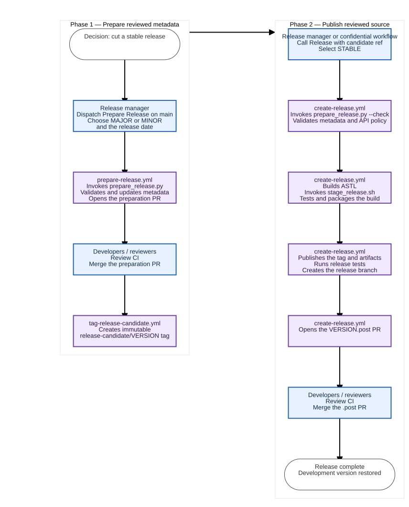

<!--
SPDX-FileCopyrightText: Copyright 2026 Arm Limited and/or its affiliates <open-source-office@arm.com>

SPDX-License-Identifier: Apache-2.0
-->

# Internal development and releases

This guide is for Arm contributors with access to the Arm-Debug repositories
and internal services. Public builds and use of ASTL do not require these steps.
See the [main README](../README.md) for public installation, build, and usage
instructions. All commands below assume the ASTL repository root.

Development changes are made in [Arm-Debug/ASTL](https://github.com/Arm-Debug/ASTL)
and mirrored to [arm/ASTL](https://github.com/arm/ASTL). The confidential source
checkout is [Arm-Debug/ASTL-confidential](https://github.com/Arm-Debug/ASTL-confidential).

## Internal service status

These badges and their destinations may require Arm access.

[](https://github.com/Arm-Debug/ASTL/actions/workflows/integration.yml)
[](https://qlty.sh/gh/Arm-Debug/projects/ASTL)
<a href="https://arm.app.blackduck.com/api/projects/bb3f58ac-a952-4b1c-8561-61a04d23bf57">

</a>

## Confidential overlay development

Keep the `ASTL` and `ASTL-confidential` repositories in sibling directories,
then enable the confidential checkout from this repository:

```sh
just overlay-enable ../ASTL-confidential
```

The command uses an existing `ossmosis` installation when it supports the
required `materialize` command. Otherwise, it installs a pinned ossmosis commit
from GitHub into the isolated `.venv-ossmosis` virtual environment. This
requires Python 3.10 or newer and Git, but does not require activating the
environment or installing `uv`. Set `OSSMOSIS_BIN` to use a specific ossmosis
executable, or run `just overlay-install-ossmosis` to install it separately.

## Embedded configuration

Every build embeds configuration. `ASTL_EMBED_CONFIG_DIR` selects the prepared
input tree at configure time (default: this project's `config/`). Apply ossmosis
and release-profile filtering before configuration. `ASTL_RELEASE_PROFILE`
identifies the embedded input set in the generated resource manifest.

## Development hooks

ASTL uses the [pre-commit](https://pre-commit.com/) framework to format staged
files and run local quality checks.

To enable this, ensure you have the following dev tools installed:

- `pre-commit`
- the [Qlty CLI](https://docs.qlty.sh/cli/quickstart)
- `clang-format`
- `cmakelang`
- `cppcheck`
- REUSE 3.3 or later
- `jq`.

Configure the debug preset once so that cppcheck can use
`build/debug/compile_commands.json`, then install the hooks:

```sh
cmake -S . --preset debug
./scripts/hooks/install_hooks.sh --internal
```

Without an explicit option, the installer selects the Arm-Debug configuration
only when `origin` is `github.com/Arm-Debug/ASTL`; all other clones use the public configuration. Use
`--internal` or `--public` to override detection for a fork or unusual remote
layout.

Before each commit, staged files are formatted and re-staged, then Qlty and the
license checks run. Cppcheck runs when staged C or C++ source or header files
change. After those checks pass, the commit-message hook adds a
`Pre-Commit-Ran: true` trailer. Pull requests report non-blocking warnings for
non-merge commits without this trailer to help the team identify checkouts that
have not installed the hooks. A bot comment makes the warning visible in the
pull request conversation and is removed once every non-merge commit has the
trailer. The Arm-Debug configuration also installs
ossmosis staged-content and commit-message checks. Without the confidential
overlay, ossmosis uses its zero-config public policy. If the overlay later
supplies `.ossmosis.json`, the next commit automatically uses that policy
without reinstalling the hooks. The public configuration never downloads or
runs ossmosis.

Run every Arm-Debug hook manually with:

```sh
pre-commit run --config .pre-commit-config-arm-debug.yaml --all-files
```

For a public checkout, substitute `.pre-commit-config.yaml`.
Run one hook by appending its id, or skip
selected hooks for one commit with a comma-separated list such as
`SKIP=cppcheck,license-lint git commit`. To uninstall, run:

```sh
pre-commit uninstall --hook-type pre-commit
pre-commit uninstall --hook-type commit-msg
```

## Preparing Release Metadata

Stable releases use two manually initiated phases:

1. Dispatch the **Prepare Release** workflow from `main` for a major or minor
   release, or from an existing `release/` branch for a patch. Select the desired
   bump type and, if needed, the intended release date. The workflow validates the
   candidate, promotes `Unreleased`, updates `VERSION.md`, and opens a
   release-preparation PR containing both files.
2. Review and merge that PR through the normal CI and branch-protection process.
   The merge creates `releases/VERSION` and the immutable
   `release-candidate/VERSION-rc.1` tag at the reviewed merge commit.
3. Test that candidate with **Test Release Candidate**. If it needs a fix, merge
   the fix into `releases/VERSION` (and separately backport it to `main`), then
   dispatch **Prepare Release Candidate** with the next candidate number.
4. Dispatch **Release** with release type `STABLE` and the selected numbered
   candidate tag as `source_ref`. It verifies, builds, and publishes that exact
   candidate. A retry reuses an existing complete release instead of replacing
   its artifacts.
5. After the private stable release is complete, automation creates the matching
   `Go/vVERSION` module tag and publishes the release to
   [Arm/ASTL](https://github.com/Arm/ASTL/releases). The public publisher mirrors
   `release/VERSION`, `Go/vVERSION`, and `releases/VERSION`, then copies the
   release name, notes, and assets. A nightly run retries publication of any
   completed stable release that was missed.

### Normal Stable Release Flow

Start with **Prepare Release** when the team decides to cut a normal major or
minor release from `main`. The diagram distinguishes actions taken by a release
manager or reviewer from work performed by GitHub Actions and the release
scripts.



[View the Mermaid source](design/release_process.mmd).

Numbered candidate tags decouple release stabilization from later changes to
`main` and let public and confidential testing use the same reviewed ASTL
commit. Stable publication rejects branches and raw SHAs; use an immutable
`release-candidate/VERSION-rc.N` tag. After final publication, use a new patch
version rather than moving an existing candidate or stable tag.
Configure a repository tag ruleset for `release-candidate/*` so only the release
automation identity can create tags and no identity can update or delete them.
Candidate tags are mirrored to `Arm/ASTL` as immutable Git refs so public clients
can test a precisely identified source revision, but candidates do not create
public GitHub Release records or publish release assets.

The stabilization branch is created before candidate testing. After final
publication, the workflow reads the current version from `origin/main` and
opens a `VERSION.post` PR only when it advances that version. A release of
`0.2.0` therefore cannot change `0.3.0` or `0.3.0.post` back to `0.2.0.post`.
The post-release PR always starts from current `origin/main`, so release-only
fixes are not accidentally included.

The reusable **Resolve Release Source** workflow validates candidate and stable
references without publishing. ASTL-confidential uses it to test candidates and
to verify that a complete public stable release already exists.

For a release prepared before numbered candidates were introduced, dispatch
**Prepare Release Candidate** with candidate number `1` and the existing
prepared tag or commit as `source_ref`. This bootstraps `releases/VERSION` and
`release-candidate/VERSION-rc.1` without moving the legacy tag.

Scheduled and manually selected `ROLLING` releases remain single-phase: they
package the selected source revision without promoting the changelog. Rolling
tags, branches, GitHub Releases, and artifacts remain private and are not
published to `Arm/ASTL`.

To perform the first-phase metadata edit locally, run:

```bash
scripts/release/prepare_release.py --release-version 1.2.0
```

To validate an already-prepared tree without changing it, run:

```bash
scripts/release/prepare_release.py --release-version 1.2.0 --check
```

This script changes tracked metadata and is intended to run before the release
commit is reviewed and tagged unless `--check` is supplied. It does not build or
package ASTL.

## Embedded release profiles

Release staging prepares filtered config inputs before compiling the library.
The public profile retains the public artifact names. Named confidential/customer
profiles use separate build directories under `build/release-profiles/<profile>/`
and include the profile in artifact names. Apply the approved ossmosis profile
first; the confidential release wrapper resolves this selection.

`scripts/release/stage_release.sh --release-profile NAME` records the prepared
profile. It does not itself select a product overlay. Config replacements are
applied to build inputs, not to files after compilation. `--skip-build` requires
matching embedded-input and binary-checksum manifests from a previous staging
build. Switching profiles cannot reuse another profile's binary.

Embedded library packages contain no `lib/config/` tree or config ZIP. The library
binary holds the runtime resources; SDK packages still include headers, licenses,
documentation and a resource manifest. Runtime environment overrides remain
available for customer additions.
